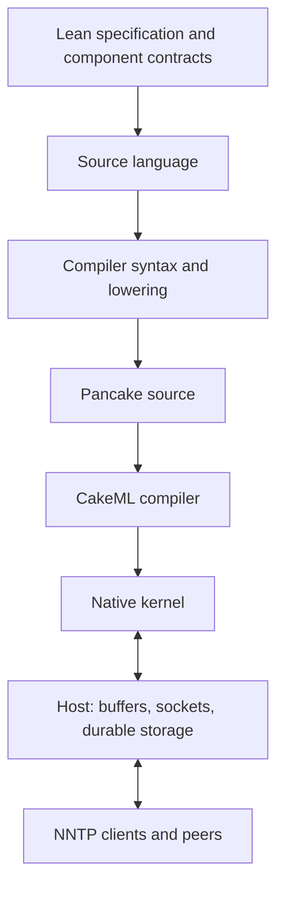

# Architecture

The intended application is an NNTP service; the reusable asset is a compiler and a small host boundary suitable for later integration into dregg. Keep the protocol state machine independent of an OS event loop, and keep article storage independent of the chosen network transport.

The diagram describes the intended path. Today the region-digest, byte-copy, decimal-render and reply-table examples traverse syntax, source emission, compilation, and native execution, and so do the server's loop, the framers and the session's program, which runs as the NNTP server's `main`; the reply table is written in the source language. Their model proofs and runtime tests cover different portions of that path; they do not yet form one theorem.

| Layer | Current home | Boundary |
| --- | --- | --- |
| Source language | `lean/DN/Dsl` | Programs as values of a Lean type, their meaning and their compilation, with one proof, in the model of the semantics, for every program the emitter accepts ([decision](decisions/0001-embedding.md)) |
| Component semantics and proofs | `lean/DN/Compiler` | Lean model of Pancake state, memory, locals, FFI oracle, and clock |
| Source emission | `DN.Compiler.Main`, `Checked`, `Syntax`, `Lower`, `Abi` | Two checked profiles: exported functions (region, echo, render, the reply table, the framers and the differential fixtures) and a whole `main` whose external calls are the host's two names (the server's loop and the session); other shapes, calls and external calls are refused with a reason |
| Backend | `backend/`, `tools.lock.json` | Patched source proof lane and separate release compiler execution lane |
| Native ABI exercise | `native/`, `DN.Compiler.Abi` | Explicit 32-bit C results/full-word output slots; independent references |
| Reference TCP host | `native/echo_server.c` | Bounded single-threaded `poll`; generated byte-copy payload path |
| NNTP server host | `native/nntp_host.c` | Single-threaded `poll`; sockets and the clock for the session's program, nothing of the protocol; each action checked against the layout |
| Host library | `crates/dn-runtime` | Bounded ownership primitives; no sockets yet |
| Concurrency models | `models/` | Small algorithms explored with Loom; separate from production code |
| Reactor models | `lean/DN/Dataplane` | Abstract invariants, not a verified connection to kernel completions |
| Preserved native implementation | `migration/dataplane` | Source for porting; old product integration remains visible |
| NNTP session | `lean/DN/News`, `DN.Server.Session` | The framing, the reply to each command line and the session specified in Lean, the framers proven; the session's program held against its model and proven in the model not to fail ([0004](decisions/0004-safety-analysis.md)) |
| Article store | `lean/DN/News` (`ArticleSpec`, `Journal`, `FsModel`, `Recovery`, `StoreOps`, `StoreRun`) | Specified as [0005](decisions/0005-article-store.md) fixes it and proven in the model, a crash at any point of the store's runs included; held against independent references; no program or host yet |

## Host contract to develop

Use bounded buffers and explicit lengths at the native boundary. A buffer identifier needs its generation and ownership state. Submission, completion, cancellation, and recycling are distinct events. Output progress must survive short writes; disconnect and error paths must release exactly the resources they own. Backpressure should stop new work before unbounded buffering becomes necessary.

An OS-specific adapter should translate real completions into a small protocol-neutral event vocabulary. The protocol step consumes a session state and bounded input, and returns output plus explicit storage/transport requests. The vocabulary is fixed by [decision 0003](decisions/0003-nntp-slice.md) and defined in `DN.Server.Layout`, which prints it as a C header for the host; the server's loop (`DN.Server.Skeleton`) runs on it, echoing payloads, and the session's program (`DN.Server.Session`) on a layout of its own (`DN.Server.SessionLayout`). Its shape was [decided](decisions/0002-entry-and-memory.md) first: the generated program's `main` runs the loop and fetches events from the host in batches through external calls, with its buffers in its own heap, because that is the only entry CakeML's compiler theorem covers, and the memory it covers without an event in the trace for every access.

## Identities

What names a connection, a file, a job and a read on the server's path, what the models name, and what a stale one does. Each pair of an index and a generation is given out once.

| Identity | Where | Width and exhaustion | A stale one |
| --- | --- | --- | --- |
| Connection | `SessionSpec` (index, generation), the program's record, `native/nntp_host.c` | Index below 64; generation 1 to 2^62, rising at its index; an index at 2^62 is not given out again | Its events are left alone, its actions not carried out, its reads abandoned (`applyEvent_opened`, `turn_gens`) |
| File place | `PostSpec` operations, `native/jobs.c` | Place below 16; the host counts a place's generation at each close, a word | An operation naming another generation ends the host |
| Job | `PostSpec` (slot, generation) | One job in flight a slot; one counter for every job, a word the program counts up from the spool's start | A completion of no job in flight stops the run (code 13) |
| Read | `PostSpec` read slots, owned by a connection's index and generation | Eight slots | Its owner gone, its completion only closes the file |
| Model key | `Io.Slab`, `Flow.Token` | Index 1 to 2^32 - 1, generation below 2^31; a slot at 2^31 is spent | Rejected by generation (`slab_stale_key_rejected_forever`); an insert with room converts (`Slab.insert_toToken`) |
| Host library | `crates/dn-runtime` `Token` | Index and a `u64` generation; a slot whose generation would overflow is retired | Rejected by generation; a token carries no owner, as there is one slab |

Deadlines are fields of a connection's record, set anew when it opens, so none outlives it.

### Operations and their leases

An operation's lease — a buffer, a read slot, a file — goes back only at the last completion the operation owes, never at a cancellation or its answer (`DN.Dataplane.Io.Lifecycle`). What each event of that model is:

| Model event | io_uring | The server's host |
| --- | --- | --- |
| `done false` | A completion without `IORING_CQE_F_MORE` | A file job's completion, handed in `dn_next` |
| `done true` | A completion with `IORING_CQE_F_MORE`: a multishot one that goes on, a zero-copy send's data completion a notification follows | Not used |
| `notif` | A zero-copy send's `IORING_CQE_F_NOTIF` | Not used |
| `cancel` | `IORING_OP_ASYNC_CANCEL` submitted | At a stop, every job |
| `answer canceled` | The cancellation's `0`, the operation's `-ECANCELED` still to come | A job not begun, dropped: dropping it is its cancelled completion, and the process ends |
| `answer already` | `-EALREADY`: found running, its completion still to come | A job running at a stop, waited for |
| `answer notFound` | `-ENOENT`: completed already, or never submitted | Does not arise: the host cancels only at a stop |

A connection gone cancels nothing: its read's job runs on, and the read slot stays taken until that job completes; the next connection at its index gets nothing of it. Shards and their routing come with the io_uring adapter (#13); until then one program owns every identity.

### Bounds

Each bound is a constant of the specification, which the layout hands the program and the host's header alike, so the three cannot disagree; what is held beyond one is refused at the boundary, and what is given back is given back on every path.

| Resource | Bound and where it is set | Held to it by | Tested by |
| --- | --- | --- | --- |
| Connections | 64 (`SessionSpec.conns`); the host stops polling the listener at 64 | The program's table; the host's `usable` | `sixty-five clients` (nntp lane), every index taken at once (faults lane) |
| Reads in flight | 8 (`PostSpec.Rules.reads`); a ninth waits | The program's read slots | Nine readers at once (session lanes) |
| Posts in flight | 4 (`PostSpec.Rules.posts`); a fifth waits | The program's slots | Five posts at once (session lanes) |
| File jobs | 12 slots (`PostSpec.jobs`), one job a slot | The host: a job in a slot in flight ends it; the program: a completion of no job, breach 13 | Session breaches 13 and 14; the host lane's breaches of files |
| Open files | 16 places (`PostSpec.places`) | The host: an operation on a place not open, of an old generation or of another job, or a seventeenth file, ends it | The host lane's breaches; session breaches 14 |
| Input and output | 512 octets an event (`SessionSpec.chunk`), one send a slot | The program: a longer event, breach 2; the host: a longer send ends it | Session breaches; `a chunk of 512 bytes` |
| Memory | The program's heap of 4 MiB and stack of 1 MiB (`SessionLayout.size_fits`); the host's tables static | The allocator holds no more once the server serves than as it began to | The faults lane: under load, allocation unchanged and at most 6 MiB more resident than at start |

At the boundary what #11 names is refused as a breach of the contract, each held by a test:

| Refused | On the server's path | Tested by |
| --- | --- | --- |
| A double recycle | A completion of no job in flight; an operation on a file closed, or closed earlier in its job | Session breach 13; the host lane's breaches |
| A return to a foreign pool | An operation on a file another job in flight names | The host lane's breaches |
| An invalid identifier | An index, a place or a slot past its table; a file's old generation | Session breaches 3 and 14; the host lane's breaches |
| A length over capacity | An event past 512 octets; a job's data past its end; more read than asked | Session breaches 2 and 14; the host lane's breaches |

Every read and file the store takes is given back on whatever path its connection left: the judge follows each, every turn, and at the end of every scenario with a store finds them all given back, the connections all gone.

On the real host a reader reset mid-article leaves no file of the spool open (the faults lane). The kernel's socket buffers are its own, outside these bounds.

### Deadlines

A connection's deadlines — its first command's, a line's, an article's, inactivity — are fields of its record, set anew when it opens (`applyEvent_opened_fresh`). So a deadline of a connection gone cannot end the one that takes its index.

With no connection able to go on, the program asks to be woken at the earliest deadline that runs, and none runs before it (`deadline_earliest`). A deadline set earlier brings the wake forward; one cleared leaves the earliest of the rest.

The host's clock is `CLOCK_MONOTONIC` in milliseconds, or the checks' virtual clock. Each turn the host polls until the wake, recomputed from it; the program's deadlines lie at most 30 minutes ahead, far below the clamp at `INT_MAX` milliseconds.

A poll that fails but by a signal ends the host with status 2, a fault of what it runs on (the faults lane's `dn/poll`), and so does a clock set back, or at 2^62 (the nntp lane). A host that passed such a clock on would see the program stop the run with code 7 (the session lanes).

A deadline is acted on at the first turn at or after it; how late that turn comes is the scheduler's, and nothing here claims it. At a stop no deadline runs on.

## Storage and offline exchange

An immutable article body with a stable Message-ID and separate group indexes is a promising starting point. Per-group article numbers and crossposts are not equivalent to filenames in a directory. Define transaction/recovery behavior before exposing posting success. Limits, retention, and policy belong beside the store contract. [Decision 0005](decisions/0005-article-store.md) fixes the local store: its files and journal, the point before which no acceptance is reported, recovery, and what of it is proved.

NNTP transports commands over a reliable byte stream. Sneakernet needs an explicit batch export/import format and ingestion path; it is not supplied by a disconnected NNTP socket. Reuse the same validation and deduplication logic for network and offline ingestion. A 9P view can later expose the store without becoming its consistency mechanism.
